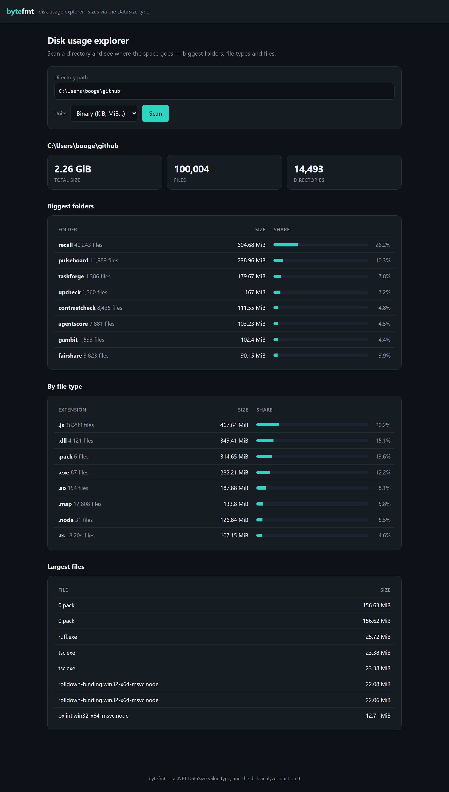

# ByteFmt

[](https://github.com/BoogeyCodes/bytefmt/actions/workflows/ci.yml)


A `DataSize` value type for .NET — and **DiskScope**, a disk-usage explorer built on it. `DataSize`
parses and formats human byte strings in both **binary** (KiB = 1024) and **decimal** (KB = 1000)
units; DiskScope scans a directory tree and shows where the space goes — the biggest folders, file
types and files — with every size rendered by `DataSize`.

Two things in one repo:

- **`ByteFmt`** — the dependency-free, NuGet-packable value type (parse, format, compare, arithmetic).
- **DiskScope** — a scan engine (`ByteFmt.DiskScan`) plus an ASP.NET Core 8 web dashboard and REST API (`ByteFmt.Web`).



## DiskScope: the disk-usage explorer

```bash
dotnet run --project src/ByteFmt.Web          # http://localhost:5000
# then enter a directory path in the UI, or:
curl "http://localhost:5000/api/scan?path=/var/log&top=10"
```

With Docker (mount the directory you want to scan read-only):

```bash
docker build -t diskscope .
docker run -p 8080:8080 -v "$PWD:/data:ro" diskscope   # then scan /data in the UI
```

A scan reports the total size, file and directory counts, the biggest immediate subfolders (sized
recursively), a breakdown by file extension, and the largest individual files. Inaccessible files and
folders are skipped and counted rather than aborting the scan. The JSON API:

```jsonc
// GET /api/scan?path=/var/log&standard=Binary&top=10
{
  "root": "/var/log", "totalBytes": 33764941, "totalHuman": "32.2 MiB",
  "files": 938, "directories": 144, "skipped": 0, "standard": "Binary",
  "topFolders":     [ { "name": "nginx", "human": "12.1 MiB", "files": 40, "percent": 37.6 }, ... ],
  "topExtensions":  [ { "extension": ".log", "human": "20.4 MiB", "files": 120, "percent": 63.5 }, ... ],
  "largestFiles":   [ { "name": "access.log", "human": "8.3 MiB" }, ... ]
}
```

> **Note:** the scanner reads the server's own filesystem. Bind the app to localhost (or run it in a
> container with a read-only mount) — don't expose it to untrusted networks.

### Scan from your own code

```csharp
using ByteFmt.DiskScan;

var result = new DirectoryScanner().Scan("/var/log", new ScanOptions { Top = 10 });
Console.WriteLine($"{result.TotalSize} across {result.FileCount} files");
foreach (var folder in result.TopFolders)
    Console.WriteLine($"  {folder.Name,-20} {folder.Size}  ({folder.FileCount} files)");
```

## ByteFmt: the `DataSize` value type

```csharp
using ByteFmt;

new DataSize(1_536).ToString();                              // "1.5 KiB"
new DataSize(2_500_000_000).Humanize(UnitStandard.Decimal);  // "2.5 GB"

DataSize.Parse("1.5 GiB").Bytes;                             // 1610612736
DataSize.Parse("900 MB").Bytes;                              // 900000000
DataSize.Parse("1,024 KB").Bytes;                            // 1024000

var total = DataSize.FromMebibytes(4) + DataSize.FromKibibytes(512); // 4.5 MiB
DataSize.FromMebibytes(1).FractionOf(DataSize.FromMebibytes(4));     // 0.25
```

### Features

- **Parse** human strings: `"2048"`, `"512 B"`, `"1.5 GiB"`, `"900 MB"`, `"1,024 KB"`, `"1K"`.
  Binary (`KiB`) and decimal (`KB`) suffixes are distinguished; a bare letter (`1K`) is treated as
  binary. Parsing is case-insensitive and tolerates thousands separators and spaces.
- **Format** with `Humanize(standard, decimals)`: the largest unit that keeps the value ≥ 1 is chosen,
  and sub-unit values are shown as whole bytes. `ToString()` uses binary units.
- **A proper value type**: immutable, non-negative, with `==`, `<`, `>`, `CompareTo`, `+`, `-`, `* int`,
  equality and hashing all keyed on the byte count, so `DataSize` sorts and compares naturally.
- **`FractionOf(whole)`** for share/percentage breakdowns, plus `FromBytes`/`FromKibibytes`/… factories.

Invalid input (`""`, `"abc"`, `"-5 KB"`, an unknown suffix) makes `Parse` throw `FormatException` and
`TryParse` return `false`. A negative size throws `ArgumentOutOfRangeException`.

### Design notes

- **Bytes are the single source of truth.** A `DataSize` stores a `long` byte count; every unit value
  is derived, so there is no rounding drift between representations and equality is exact.
- **Binary vs decimal is a choice at the edges.** The stored value is unit-agnostic; the unit standard
  is chosen when formatting and inferred from the suffix when parsing.
- **Overflow is checked.** Parsing and arithmetic use `checked` arithmetic, so an overflowing value
  fails loudly (or, for `TryParse`, returns `false`) rather than wrapping.

## Testing

```bash
dotnet test
```

Sixty-two tests: the `DataSize` value type (binary/decimal formatting at the unit boundaries,
precision, every parse form, round-tripping, operators, equality/hashing, `FractionOf`, rejected
input), the `DirectoryScanner` (totals, recursive folder sizes, extension aggregation, largest files,
the `Top` limit, empty/missing/blank-path handling), and the web API (scan totals, unit switching,
error cases, and the rendered pages) via `WebApplicationFactory`. CI runs on Linux and Windows and
packs the NuGet package.

## Project layout

```
src/
├── ByteFmt/           the DataSize value type (NuGet package)
│   ├── DataSize.cs    parse, format, operators, FractionOf
│   └── UnitStandard.cs binary/decimal units and suffix resolution
├── ByteFmt.DiskScan/  the directory scan engine (DirectoryScanner, ScanResult)
└── ByteFmt.Web/       the ASP.NET Core dashboard + REST API
tests/
├── ByteFmt.Tests/           xUnit tests for the value type
├── ByteFmt.DiskScan.Tests/  scanner tests over a temp tree
└── ByteFmt.Web.Tests/       WebApplicationFactory integration tests
```

## License

MIT
